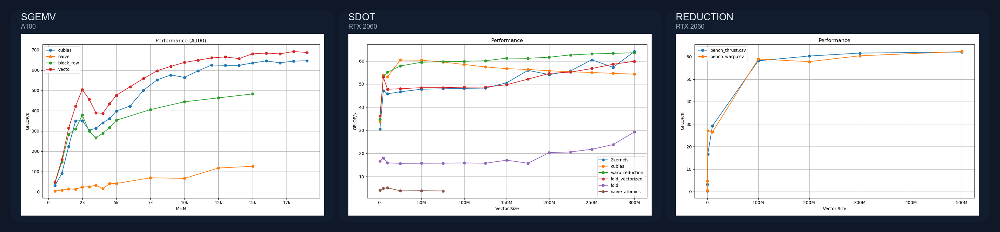

# libthom

`libthom` is a collection of CUDA implementations for common linear algebra operations. I made this repository to bring my work on different routines together and keep track of the performance evolution through successive iterations. In that sense it is an experimental project, **not a production library**. However it allows me to explore the tooling needed to target different GPU microarchitectures from one codebase, and manage that at compile time. It includes reference implementations such as cuBLAS and Thrust, with command-line tools to check results and compare performance.



## Routines

| Routine | Description | Details |
| --- | --- | --- |
| `reduction` | Sum a vector. | [Source and notes](routines/reduction/) |
| `sdot` | Single-precision dot product. | [Source and notes](routines/sdot/) |
| `sgemv` | Single-precision general matrix-vector multiplication. | [Source and notes](routines/sgemv/) |
| `dgemm` | Double-precision general matrix multiplication. | [Source and notes](routines/dgemm/) |
| `hgemm` | Half-precision general matrix multiplication. | [Source and notes](routines/hgemm/) |

The plots above show selected benchmark results: SGEMV on an NVIDIA A100, and SDOT and Reduction on an NVIDIA RTX 2060. These are the two main GPUs i've been working with (locally on a 2060, and using an A100 from a cloud when needed)

## Future work

In addition to any new routine I might work on, I want to make this project multi-platform, probably first by adding Metal kernels, and maybe later targeting AMD GPUs.

## Requirements

- NVIDIA GPU and a compatible NVIDIA driver
- CUDA Toolkit with `nvcc`, cuBLAS, and cuRAND
- CMake 3.28 or newer
- A C++ compiler supported by the installed CUDA Toolkit

The build compiles for all CUDA architectures by default. To target a specific compute capability, set `ARCH` (for example, `80` for A100). Choose an architecture supported by your GPU and CUDA Toolkit.

## Build

Build all routines:

```sh
cmake -S . -B build -DARCH=80
cmake --build build
```

Build a single routine:

```sh
cmake -S . -B build -DARCH=80 -DROUTINE=sgemv
cmake --build build
```

Available `ROUTINE` values are `reduction`, `sdot`, `sgemv`, `dgemm`, and `hgemm`. Use `-DROUTINE=all` (the default) to build them all.

## Run

The executable is `build/libthom`. Each routine has its own implementations and arguments. The general command format is:

```sh
./build/libthom <test|bench> <routine> <implementation> [arguments...]
```

For example, list the implementation names in the selected routine's source, then run a correctness check or a benchmark:

```sh
./build/libthom test reduction warp 1000000 10
./build/libthom bench reduction warp
```

Exact argument counts vary by routine. The `test` mode accepts a size, iteration count, and optional result-check flag; `bench` runs the routine's configured set of sizes. Some implementations are only compiled for certain GPU architectures. See the routine source and notes for implementation-specific details.
