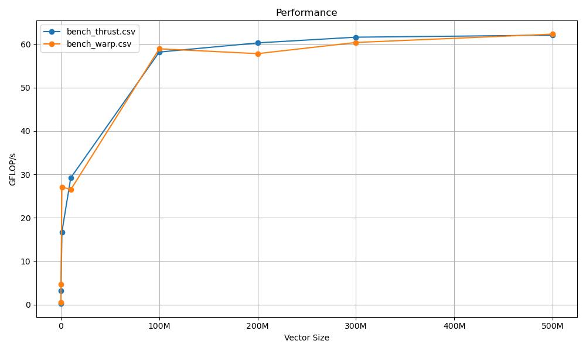

# Reduction routine

### Implementations:
- warp: just some playing around with reductions, implemented an example with the addition operator using 2 kernels, the first one computes result block wide, by doing a warp level reduction with the __shfl_down_sync instruction and then a block level reduction using shared memory. Each block writes its result in global memory. The second kernel then launch a single block that reduces the results from each blocks, using the same warp-level then block-level approach.

- thrust reference implementation from NVIDIA CCCL's Thrust library.

### Benchmark:

NVIDIA RTX 2060:

| Elements | "warp"  (gflop/s) | "thrust" (gflop/s)|
| ----     | ------     | -------  |
| 10'000      | 0.543107| 0.280878 |
| 100'000     | 4.75214 | 3.19396 |
| 1'000'000   | 27.1228 | 16.7378 |
| 10'000'000  | 26.4968 | 29.2181 |
| 100'000'000 | 58.9411 | 58.1856 |
| 200'000'000 | 57.8254 | 60.2985 |
| 300'000'000 | 60.3975 | 61.6153 |
| 500'000'000 | 62.317  | 62.0782 |

