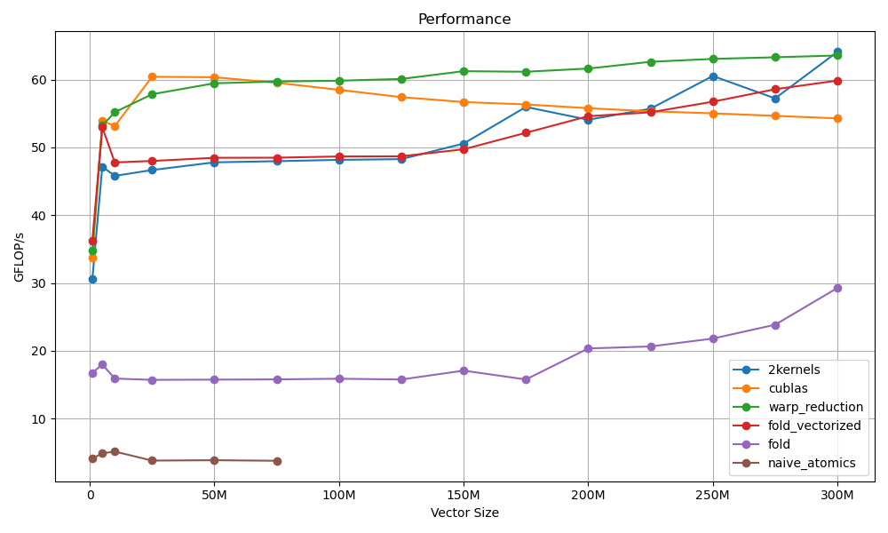

# sdot

Some work on the sdot routine (simple precision dot product) as a learning project:

## Implementations:
- **sdot_cublas.cu**: reference implementation
- **sdot_naive_atomics.cu**: block-wide reduction using shared-memory atomics then grid-wide reduction using global mem atomics
- **sdot_fold.cu**: block-wide reduction in log2(n) steps, still GMEM atomics for grid-wide reduction
- **sdot_fold_vectorized.cu**: adding vectorized reads from GMEM to registers
- **sdot_2kernel.cu**: using a second kernel to reduce results from each block, instead of GMEM atomics.
- **sdot_warp.cu**: using warp level intrinsics for the first kernel (block-wide reduction) instead of doing it fully in SMEM.

# Blog post

More explanations with figures, details, and profiling analysis:

https://thom.gg/fighting-cublas-sdot

