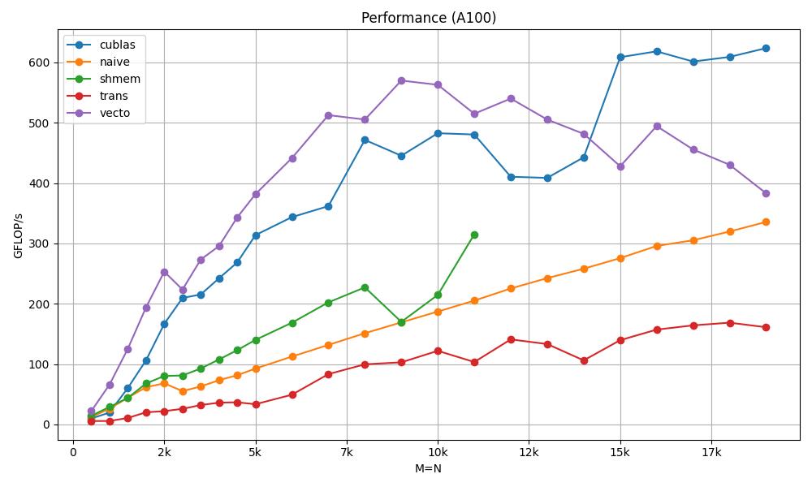

# SGEMV
Some work on the SGEMV routine (simple precision general matrix vector multiplication) as a learning project:

## Implementations

### Row major:
- **sgemv_naive.cu**: every row is a dot product that can be computed independently, starting naively with one thread per row.
- **sgemv_block_row.cu**: using a full thread block per row, warp level reductions and then smem reduction to reduce the values within the block.
- **sgemv_vecto.cu**: adding vectorized loads. (95% of peak memory throughput)

### Col major:
- **sgemv_col1_naive.cu**: 1 thread per row
- **sgemv_col2_shmem.cu**: loading the x vector in shared memory
- **sgemv_col4_trans.cu**: tried doing a matrix transpose then calling my best row major kernel
- **sgemv_col3_vecto.cu**: using vectorization, and therefore rethinking the layout. (see blog post or code)

# Blog post:    
More explanations with figures and diagrams:

https://thom.gg/fighting-cublas-sgemv

